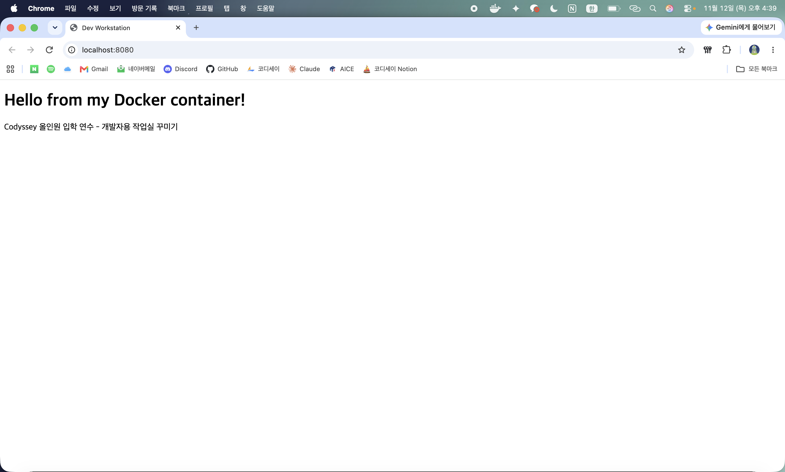

# Dockerfile 커스텀 이미지 및 포트 매핑 로그

## 1. 선택한 방식과 기존 베이스

- 방식: (A) 웹 서버 베이스 이미지 활용 + 정적 콘텐츠 교체
- 기존 베이스: `nginx:alpine`

## 2. 파일 구성과 Dockerfile

```
$ ls -l
total 8
drwxr-xr-x  3 <사용자>  staff   96 11월 12 16:27 app
-rw-r--r--  1 <사용자>  staff  125 11월 12 16:27 Dockerfile
drwxr-xr-x  6 <사용자>  staff  192 11월 12 16:24 docs
drwxr-xr-x  4 <사용자>  staff  128 11월 11 19:44 practice
$ cat Dockerfile
FROM nginx:alpine
LABEL description="Codyssey dev-workstation mission web server"
COPY app/ /usr/share/nginx/html/
EXPOSE 80
```

## 3. 커스텀 포인트와 목적 (초안)

| 커스텀 포인트 | 목적 |
|---|---|
| `COPY app/ /usr/share/nginx/html/` | nginx의 기본 페이지를 내가 만든 `index.html`로 교체하기 위함 |
| `LABEL description=...` | 이미지에 설명 정보를 남기기 위함 |
| `EXPOSE 80` | 이 컨테이너가 80번 포트를 사용함을 명시하기 위함 |
| 태그 `1.0` | 이미지 버전을 구분하기 위함 |

## 4. 이미지 빌드

```
$ docker build -t dev-workstation-web:1.0 .
[+] Building 59.9s (7/7) FINISHED                                 docker:desktop-linux
 => [internal] load build definition from Dockerfile                              0.0s
 => => transferring dockerfile: 162B                                              0.0s
 => [internal] load metadata for docker.io/library/nginx:alpine                   5.2s
 => [internal] load .dockerignore                                                 0.0s
 => => transferring context: 2B                                                   0.0s
 => [internal] load build context                                                 0.0s
 => => transferring context: 319B                                                 0.0s
 => [1/2] FROM docker.io/library/nginx:alpine@sha256:713fc2ebfd92e8217db4514771  54.2s
 => => resolve docker.io/library/nginx:alpine@sha256:713fc2ebfd92e8217db45147718  0.0s
 => => sha256:89c6596257b9d12ce2575004824f3e3b50c7a5a697c8ad0b35 1.40kB / 1.40kB  0.4s
 => => sha256:f4a8c3eaf8557b623e36fc679639169db4b2b08e5b5d9bc 20.12MB / 20.12MB  54.0s
 => => sha256:1b5b466c140b4f23d171a39e5939a58b1ff45918bc73e2bf96 1.21kB / 1.21kB  1.4s
 => => sha256:b25486411ab9275b48a1081fef3ae9492ea2660594cf6da3d9c4db 405B / 405B  1.4s
 => => sha256:5faf28e117a4469b80f113fb06808aa5a852e89a047cdc0cc526af 964B / 964B  1.0s
 => => sha256:a6fb6399df148ab1f9108ee7045c0ad2b46f5c3cac90dbb8d2f802 629B / 629B  0.4s
 => => sha256:66eb34db8c0498543c0923d252303d579e40f0bb457755bb6 1.96MB / 1.96MB  14.6s
 => => sha256:b90627b8f4292fd3cb63f0f27f0b11c37f04ba88ef3b78d49 4.19MB / 4.19MB  44.6s
 => => extracting sha256:b90627b8f4292fd3cb63f0f27f0b11c37f04ba88ef3b78d4948ea0a  0.1s
 => => extracting sha256:66eb34db8c0498543c0923d252303d579e40f0bb457755bb61d5d8e  0.0s
 => => extracting sha256:a6fb6399df148ab1f9108ee7045c0ad2b46f5c3cac90dbb8d2f8020  0.0s
 => => extracting sha256:5faf28e117a4469b80f113fb06808aa5a852e89a047cdc0cc526af9  0.0s
 => => extracting sha256:b25486411ab9275b48a1081fef3ae9492ea2660594cf6da3d9c4db3  0.0s
 => => extracting sha256:1b5b466c140b4f23d171a39e5939a58b1ff45918bc73e2bf96b5464  0.0s
 => => extracting sha256:89c6596257b9d12ce2575004824f3e3b50c7a5a697c8ad0b35839e3  0.0s
 => => extracting sha256:f4a8c3eaf8557b623e36fc679639169db4b2b08e5b5d9bc52c62504  0.2s
 => [2/2] COPY app/ /usr/share/nginx/html/                                        0.0s
 => exporting to image                                                            0.4s
 => => exporting layers                                                           0.0s
 => => exporting manifest sha256:eaeb4de2eaae40c2637533bc50da26b841fcbcc3286c494  0.0s
 => => exporting config sha256:0691bc658e2c8dcd51f7fc430c956155b9a211f5236da2915  0.0s
 => => exporting attestation manifest sha256:d02c952d30d051d63cac7824c371999f84d  0.0s
 => => exporting manifest list sha256:747fd13d72b9376b831f4a423843acc09a8584ac75  0.0s
 => => naming to docker.io/library/dev-workstation-web:1.0                        0.0s
 => => unpacking to docker.io/library/dev-workstation-web:1.0                     0.3s
$ docker images
                                                                  i Info →   U  In Use
IMAGE                     ID             DISK USAGE   CONTENT SIZE   EXTRA
dev-workstation-web:1.0   747fd13d72b9       93.2MB         26.3MB        
hello-world:latest        cf1b20a0c89a       22.6kB         10.3kB    U   
ubuntu:latest             065aa8626841        181MB         44.9MB    U   
```

## 5. 포트 매핑으로 컨테이너 실행 (8080:80)

```
$ docker run -d -p 8080:80 --name dev-web dev-workstation-web:1.0
6752c4e73fb225ee58a1a6d183013767a45ca7a638580c8bf1cc7620d0bdc4d1
$ docker ps
CONTAINER ID   IMAGE                     COMMAND                   CREATED        STATUS                  PORTS                                     NAMES
6752c4e73fb2   dev-workstation-web:1.0   "/docker-entrypoint.…"   1 second ago   Up Less than a second   0.0.0.0:8080->80/tcp, [::]:8080->80/tcp   dev-web
```

## 6. 접속 증거

### 6-1. curl 응답

```
$ curl http://localhost:8080
<!DOCTYPE html>
<html lang="ko">
<head>
  <meta charset="UTF-8">
  <title>Dev Workstation</title>
</head>
<body>
  <h1>Hello from my Docker container!</h1>
  <p>Codyssey 올인원 입학 연수 - 개발자용 작업실 꾸미기</p>
</body>
</html>
```

### 6-2. 컨테이너 로그 (요청이 컨테이너에 도달한 기록)

```
$ docker logs dev-web
/docker-entrypoint.sh: /docker-entrypoint.d/ is not empty, will attempt to perform configuration
/docker-entrypoint.sh: Looking for shell scripts in /docker-entrypoint.d/
/docker-entrypoint.sh: Launching /docker-entrypoint.d/10-listen-on-ipv6-by-default.sh
10-listen-on-ipv6-by-default.sh: info: Getting the checksum of /etc/nginx/conf.d/default.conf
10-listen-on-ipv6-by-default.sh: info: Enabled listen on IPv6 in /etc/nginx/conf.d/default.conf
/docker-entrypoint.sh: Sourcing /docker-entrypoint.d/15-local-resolvers.envsh
/docker-entrypoint.sh: Launching /docker-entrypoint.d/20-envsubst-on-templates.sh
/docker-entrypoint.sh: Launching /docker-entrypoint.d/30-tune-worker-processes.sh
/docker-entrypoint.sh: Configuration complete; ready for start up
2026/11/12 07:31:27 [notice] 1#1: using the "epoll" event method
2026/11/12 07:31:27 [notice] 1#1: nginx/1.31.8
2026/11/12 07:31:27 [notice] 1#1: built by gcc 15.2.0 (Alpine 15.2.0) 
2026/11/12 07:31:27 [notice] 1#1: OS: Linux 7.0.14-linuxkit
2026/11/12 07:31:27 [notice] 1#1: getrlimit(RLIMIT_NOFILE): 1048576:1048576
2026/11/12 07:31:27 [notice] 1#1: start worker processes
2026/11/12 07:31:27 [notice] 1#1: start worker process 30
2026/11/12 07:31:27 [notice] 1#1: start worker process 31
2026/11/12 07:31:27 [notice] 1#1: start worker process 32
2026/11/12 07:31:27 [notice] 1#1: start worker process 33
2026/11/12 07:31:27 [notice] 1#1: start worker process 34
2026/11/12 07:31:27 [notice] 1#1: start worker process 35
2026/11/12 07:31:27 [notice] 1#1: start worker process 36
2026/11/12 07:31:27 [notice] 1#1: start worker process 37
2026/11/12 07:31:27 [notice] 1#1: start worker process 38
2026/11/12 07:31:27 [notice] 1#1: start worker process 39
2026/11/12 07:31:27 [notice] 1#1: start worker process 40
2026/11/12 07:31:27 [notice] 1#1: start worker process 41
192.168.65.1 - - [12/Nov/2026:07:31:28 +0000] "GET / HTTP/1.1" 200 249 "-" "curl/8.7.1" "-"
```

### 6-3. 브라우저 접속 화면 (주소창에 `localhost:8080` 포함)


